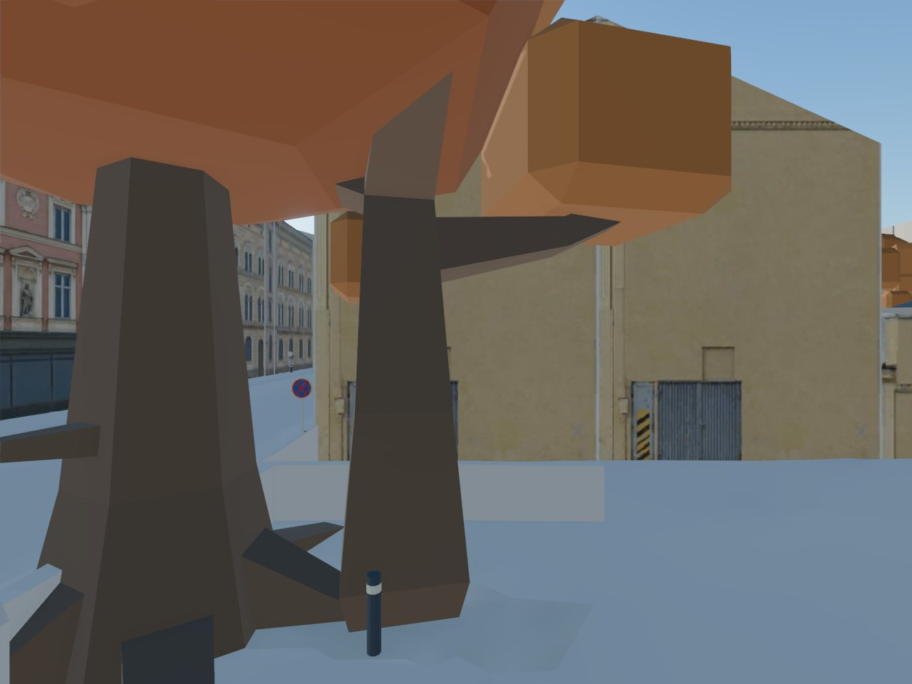
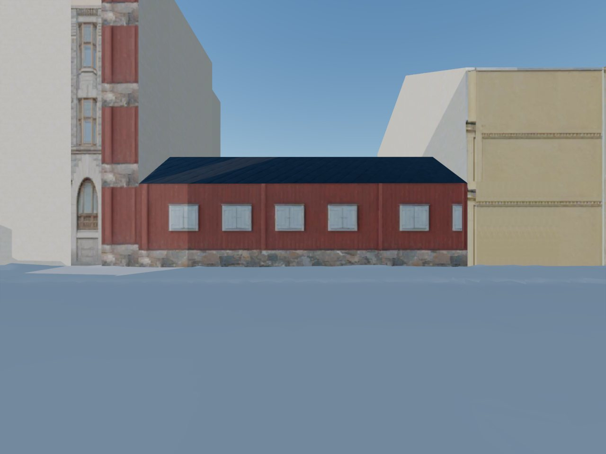
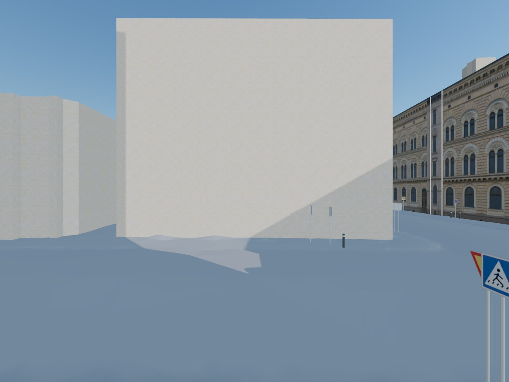
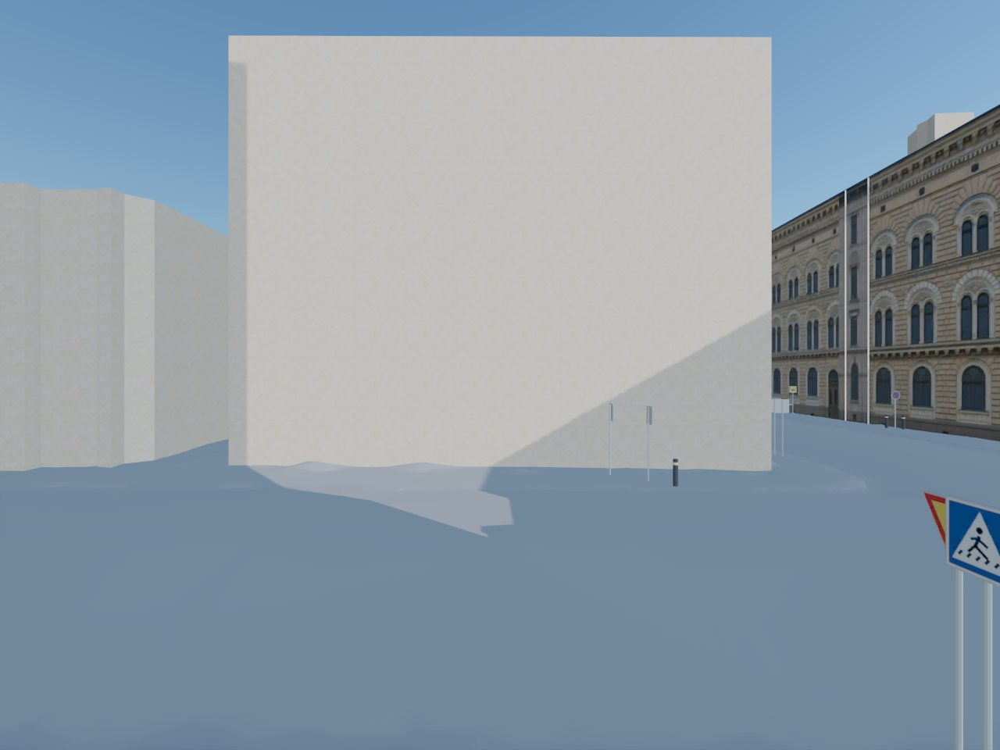

# Facade rollout: three high-visibility buildings

Date: 2026-10-27. Sandbox: `content-facades-1027-1402`. The approval inventory hash stayed `ae978911…4df2f`; all 218 street-facing core walls remain bound. Reference imagery and the reference/generated contact sheet remain only in `$TURKU3D_WORK/reports/content-facades-1027-1402/`.

## Reference screening and decisions

The rollout screened full views in Look Around → Google → Mapillary order, with fallback views and an Astra/low reference-grid read. The queue at `$TURKU3D_WORK/textures/rollout-queue.json` contains only these buildings. Nine walls were screened; the widest passing wall per building was generated with Luna/low, reviewed by Astra/low, and retried once when rejected.

| Building | Source wall | Reference and decision | Image calls |
| --- | --- | --- | ---: |
| `gis-103304662E` | `_16`, 16.48 × 4.41 m | Look Around showed the one-storey green storefront. Rejected after retry: the far-left glazed opening became solid panels; the opening grid fails QA. The 3.73:1 aspect was explicitly included despite the rollout's automatic deferral. Existing neighbour style remains. | 2 |
| `103304659B` | `_65`, 8.91 × 14.28 m | Look Around showed a yellow blank gable with a ground-level gate. `_64` is marginally wider but foliage obscured it. Accepted on the first image: the grid, orthographic framing and clean checks pass, and manual inspection confirms the gate, cornice and colour. | 1 |
| `gis-103304660C` | `_0`, 22.02 × 17.76 m | Look Around showed the five-storey wall. Rejected after retry: a ground-floor opening is too wide and a pale border remains. Existing neighbour style remains. | 2 |

The accepted `_65` map was published under the export lock. `facade_derive` selected it as the building style and staged all seven other walls of `103304659B` successfully. The plan changed from 35 generated / 123 derived / 60 neighbour-derived to **36 / 130 / 52**; all 218 remain bound. The derived contact sheet is in the sandbox report directory. The source is a blank gable, so its derived maps carry that blank upper treatment to the other walls; their facade-specific window patterns remain a visual follow-up.

**Quota:** 30% before, 31% after. Five image calls total, below the task cap of 12. The rollout summary is `$TURKU3D_WORK/reports/content-facades-1027-1402/batch-02.json`.

## Tile and ground checks

All three buildings lie in `t0_0_0`; the sandbox rebuild used the published layers and updated approval assembly. The tile is **4,893,804 wire bytes** (6,765,900 GLB bytes), below the 8 MB wire cap. The package reports 218 bound facades. The facade ground audit sampled all 218 and passed; 61 bases are reported buried by sloped terrain, including two `103304659B` walls. No new floating-base failure was reported.

## Game captures

These are Chrome game renders at wall-facing camera poses, not reference photos. Both backends loaded the assembled tile without page errors. The rejected buildings still display their existing neighbour-derived maps.

| Wall | WebGPU | WebGL2 |
| --- | --- | --- |
| Accepted `103304659B_65` |  |  |
| Rejected `gis-103304662E_16` |  |  |
| Rejected `gis-103304660C_0` |  |  |

The accepted gable is partly occluded by a tree from the chosen street pose. Capture poses, raw renders and the backend result JSON are in the sandbox report directory.

## Verification

```sh
source ~/turku3d/wt/content-facades-1027-1402/sandbox.env
cd ~/turku3d/wt/content-facades-1027-1402/repo
make tile-build T=t0_0_0
bash pipeline/env/run.sh python -m turku3d.package.facade_ground_audit
scripts/dev/gate --fast --base main
```
