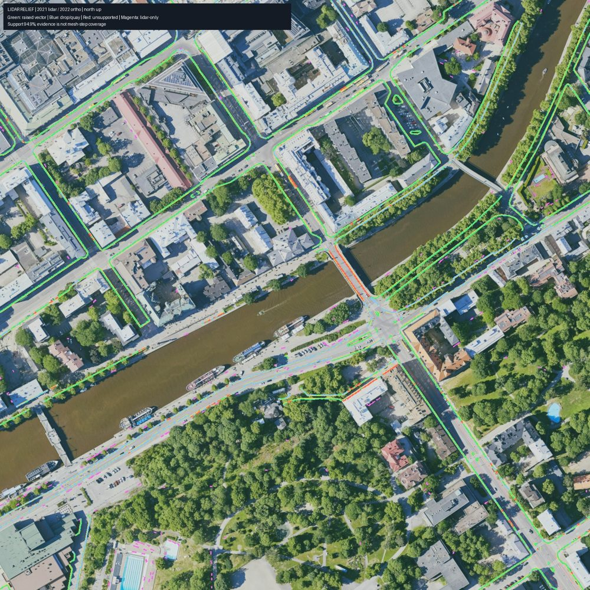

# W1-13 lidar toolkit and relief evidence

Completed for the revised scope on 2026-10-25. Curbs were deferred from the current
playable-block release; the reusable toolkit and detection remain for the next iteration.
The delivery branch changes no ground or assembler implementation. No main merge was performed.

## Measured coverage

The four Phase 1 visual tiles plus 50 m margin cover engine x/z [-50, -50, 550, 550].
The 0.25 m raster uses 28,852,145 source returns from nine read-only LAZ tiles.
A deterministic coordinate hash reserves 20% before selection and fitting; the remaining
23,080,599 returns provide 8,775,503 accepted ground points.

| Mapped 62520 curb metric | Metres |
|---|---:|
| Total source length (75 unique line geometries) | 7597.0 |
| Supported two-sided profiles | 7206.6 |
| Raised relief >=3 cm | 4971.6 |
| Measured flush/drop spans | 2235.0 |
| Unsupported | 390.4 |

Profile confirmation is **94.86%**, above the 85% detection target.
This includes measured flush/drop spans: it is **not real mesh-step coverage**.
Length-weighted median absolute step is **6.14 cm**;
p90 is **12.67 cm**. Unsupported stations terminate exported lines.

| Added lidar-only relief class | Metres |
|---|---:|
| quay | 79.8 |
| curb | 386.5 |
| wall_planter_edge | 79.6 |
| step | 4.7 |

Total: **550.7 m across 199 polylines**.
Candidates exclude the 0.8 m mapped-curb corridor, building interiors (+0.3 m), and water.
Every surviving addition has measured two-sided profiles, confidence >=0.25, step >=5 cm,
and length >=2 m. Heights/slopes determine classes; semantic labels still need review.
The 8,765 typed blob/shape candidates are hypotheses for later props,
not validated prop placements. Final detector wall time was 707.0 s under
concurrent host load; this is not an isolated city-throughput benchmark.



Green: raised mapped relief; blue: measured drops/quays; red: unsupported mapped spans;
magenta: lidar-only additions. Full-resolution map and intermediate rasters remain in the sandbox.

## Cache and tests

Collision tile `c_2_3` has 275,789 points. Three fresh-store mmap reads,
each forcing a full xyz checksum, took 0.01277 / 0.02729 / 0.01592 s.
LAZ decoding, identical cropping and the same checksum took 10.319 / 12.714 / 8.728 s.
Median speedup: **648.2x**, exceeding 10x. Both paths used the warm OS file cache;
initial source partitioning is excluded from repeated-access timing. Cached counts and
coordinate checksums matched the LAZ crops on every repeat.

The pre-batch-1 gate on main `2d75e2c` passed policy, generated materials, Python lint/format
and **88 pipeline tests in 8.516 s total** (pytest 8.17 s). The nine lidar tests
cover cache invalidation/mmap, polygon/class/return queries, signed steps on slopes,
outlier rejection, support holes, edge linking, withheld splits, CHM semantics, typed
objects and comparison accounting. No checks or thresholds were weakened.

Rebased onto batch-1 main `8c1f9a5` on 2026-10-25, preserving main's newer
`matplotlib>=3.9` dependency. Synced the editable Python packages and development
requirements. The only changed npm lockfile, `textures/node/package-lock.json`,
was deleted upstream; no retained npm lockfile changed. Post-rebase verification:
**9 lidar tests passed in 1.80 s**, using one worker and one numerical thread;
Ruff lint and format checks passed for all 12 lidar Python files. The full gate
was deliberately not rerun, as requested by the orchestrator for this rebase.
The orchestrator runs the landing gate.

```sh
source ../sandbox.env
uv pip install --python .venv/bin/python -e 'pipeline[dev,fetch,lidar]' -e 'textures[post,dev]' -r scripts/dev/requirements.txt
OPENBLAS_NUM_THREADS=1 OMP_NUM_THREADS=1 .venv/bin/python -m pytest pipeline/tests/test_lidar.py -q
.venv/bin/ruff check pipeline/turku3d/lidar pipeline/tests/test_lidar.py
.venv/bin/ruff format --check pipeline/turku3d/lidar pipeline/tests/test_lidar.py
```

## Reproduce

From the w1-13-lidar worktree:

```sh
source ../sandbox.env
scripts/dev/gate
.venv/bin/python -m pytest pipeline/tests/test_lidar.py -q
OPENBLAS_NUM_THREADS=1 OMP_NUM_THREADS=1 bash pipeline/env/run.sh python -m turku3d.lidar relief --scope phase1
bash pipeline/env/run.sh python -m turku3d.lidar benchmark --tile c_2_3 \
  --output "$TURKU3D_WORK/reports/lidar/cache-benchmark.json"
```

Outputs: `$TURKU3D_WORK/reports/lidar/phase1/coverage.{json,md}`, `coverage-map.jpg`,
`surfaces.npz`, `objects.json`, `breaklines.json` and `added-breaklines.json`.
Use **added-breaklines.json** to add missing lines to city-vector ground; loading all
segmented mapped vectors as additions would duplicate existing constraints.
The W1-01 contract uses engine `centers_xz`, unit `normals_xz`, absolute N2000
`side_heights` (minus/plus normal), `kind`, with extra confidence/class/provenance fields.
See [the toolkit README](../../pipeline/turku3d/lidar/README.md) for Python API/CLI examples.

Machine-readable evidence: [lidar-relief.json](lidar-relief.json).
Detector code hash: `c644f07d794df5f06ea4ebf85c6fea4c4c66dcad5f2f1a44cb56ca93f3c6e51d`.
Source identity: `6207a25024a1bebc90a8cf3e4fdfac32dd358034907120bed7139d63bc397078`. Original gate JSON is
`$TURKU3D_WORK/reports/lidar-rebased-gate.json`.

## Deferred integration and follow-ups

Before/after ground mesh-step counts are **not measured**. The historical curb-CDT
baseline was stopped before publication after the user deferred curbs; no provisional
layer is presented as accepted. Experimental integration commits are retained at
`archive/w1-13-lidar-relief-experiment` (`5a5bb9a`) and excluded from the delivery diff.
The standalone `python -m turku3d.lidar.compare` utility can compare saved collision
layers at identical independently observed stations when that experiment resumes.

Next curb iteration: review lidar-only false positives/line continuity; rebuild ground
with added breaklines; report before/after real mesh-step length and independent step
error. Review object semantics before creating props. Selective lidar gate routing was
requested from the active gate-speed owner to avoid competing routing edits.
