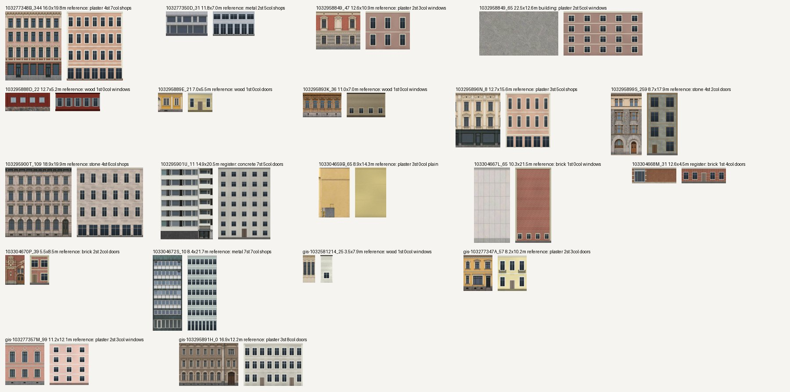

# Fast facade pass: rough maps from photo-read parameters

Task `textures-fast-facade-pass`, 2026-10-27. Request (Jonni, 22:15): a cheaper and faster way
to put approximate textures on the street-facing facades from the panoramas, as a quick second
pass as soon as ground and buildings are in. Tooling: `turkutex.facade_fast` (plan, refs,
describe, render, contact, publish) and `turkutex.facade_fast_render` (schema validation,
fallbacks, renderer). Method and commands: `textures/README.md`, "Fast facade pass".

**Approach.** One vision call per wall reads the screened reference crop into about fifteen
parameters; a deterministic renderer draws the map from those parameters alone. No photo pixel
reaches the map, so it is publishable like a derived map. Street imagery stays in the sandbox.

## Step 1: measurement on 20 walls

Twenty street walls that already carry an accepted generated map, one per building (19
buildings, 3,122 m²), so the fast map can be compared with the slow pipeline's result.

| Stage | Wall time | Per wall | Notes |
| --- | ---: | ---: | --- |
| `refs` (Look Around → Google → Mapillary, 4 views, 8 workers) | 469 s | 23 s | host load average 180–250; HEIC decoding dominates |
| `describe` (gpt-6-astra/low, `-j 8`) | 65 s | 3.2 s | 15.3 s per call (10.5–22.2 s), 20 of 20 calls valid |
| `render` (render + 3 KTX2 encodes, `-j 8`) | 9–17 s | 0.4–0.8 s | 550 KB for 20 walls at 16 px/m |

**Quota per wall.** A call used 17,757 input tokens (2,118 cached), 163 output and 54 reasoning
tokens. The weekly reading went 38 → 39 % during the 65 s, but the reading is account-wide and
integer, and other agents ran at the same time, so it cannot resolve a single call. Calibrated
from this week's rollouts instead (127 M weighted tokens for 38 points, weighting cached input
0.1 and output 8, all models priced alike): **about 0.005 points per wall**, so a 100-wall
tile costs **about 0.5 %** of the weekly quota. That is within the 1 % per tile budget, so the
pass continues. The calibration is approximate (factor 2 either way); the four-tile run below
reads the quota before and after more calls.

**What the model reads right** (against the generated maps' own reviewer readings and their
median wall colour, glass excluded):

| Field | Agreement |
| --- | --- |
| wall visible | 17 of 20 yes; the 3 no's are right (pavement and railing, a tree and wall in front, foliage) |
| storeys | 12 of 14 walls with a reviewer count |
| window columns, multi-storey walls | 9 of 11 exact, 1 off by one on the others but one (2 for 4) |
| wall colour, ΔE76 to the map | median 13.1 (library default `render_smooth`: 30.1); 6 walls below 8 |
| material | right on 18 of 20; a white panel gable read as brick, a dark curtain wall as metal |

Colour misses are mostly lighter than the map (`#e7dcaa` for an ochre `#b89c65`). Single-storey
walls give 0 window columns by the schema's definition; their openings come from
`ground_openings`. Every field of the schema was used and none was unreliable enough to drop,
so the schema stays as measured: 15 fields, all required (`schemas/facade_fast_description.schema.json`).

**Look.** Each pair below is the accepted generated map (left) and the fast map (right) at the
same metric scale, 8 px/m. The fast maps keep the storeys, window rhythm, ground-floor type and
colour family. They lose ornament, real proportions of individual openings and the material
detail that the generated maps carry. Three walls show fallbacks: `1032958849_65` takes its
building's other reading, `103295901U_11` and `103304668M_31` take the register's description.

**Time budget.** The budget is 5 minutes for a 100-wall tile. Describe (about 40 s at `-j 8`)
and render (about 40 s) fit. Reference rendering at 23 s per wall does not: it would take about
40 min for 100 walls on this loaded host. `facade_fast refs` therefore renders at most two views
per wall (`--max-views 2`) instead of the rollout's four; the next section measures it.
