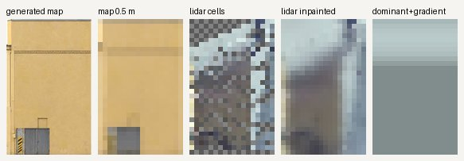
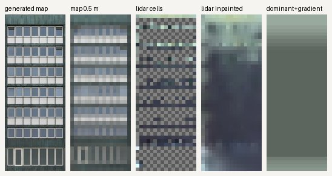
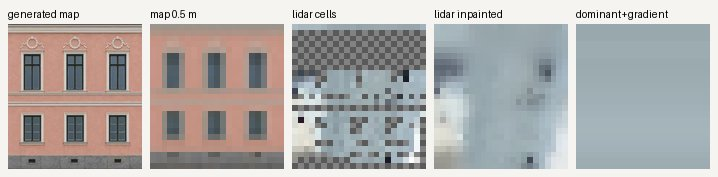

# Lidar point colours on facades: measurement and decision

Task `textures-lidar-facade-color`, 2026-10-27. Idea (Jonni, 22:05): colour the facades that have
no texture of their own from the lidar point cloud's colours, over a gritty base texture.

**Decision: (c), nothing useful.** On walls, the city lidar's colours are those of the roof above
or of the ground in front. They are not the facade's. A wall's dominant lidar colour is further from
its accepted generated map than a single constant colour is: median ΔE 24.3 against 12.7. The
per-cell colours carry no facade structure: the lightness correlation with the map is about 0.
No lidar colour producer was built and no `source_mode: lidar` exists. Unbound walls keep the
library material (`render_smooth`).

## Data and method

- Points: city `pistepilvi` LAZ 2021 (LAS 1.2, format 3; 8-bit RGB stored as 16 bits; colours
  taken from the 2021 aerial imagery), read raw with `turku3d.lidar.walls`.
- Walls: the buildings layer `facades.geojson` (the approved inventory, same SHA-256). Each wall's
  points are projected into the wall frame: `u` along the baseline from the left edge as seen from
  outside, `h` above the wall base, and `d` the signed distance from the plane, outward positive.
- Wall points: |d| ≤ 0.6 m, inside the wall rectangle, h ≥ 0.3 m, and not ground, vegetation,
  noise or key points (classes 2, 3, 4, 5, 7, 8, 18). The `d` histograms peak at |d| < 0.2 m, so
  the planes are registered. Most of these points are class 6 (building) or class 12.
- Reference: the bound KTX2 albedo of each wall, decoded and averaged into 0.5 m cells at the
  same u, v. These are the accepted generated map, or the map derived from the building's style.
- Smear test: the roof colour is the median of class 6 points 0.3–3 m inside the wall and from
  1.5 m below to 3 m above its top. The ground colour is the median of points 0.6–3 m in front
  of the wall, within 0.5 m of its foot.
- Baselines: the default library material (`render_smooth`, median sRGB 227/212/194), which is
  what an unbound wall shows today. The second baseline is one constant colour: the median colour
  of the other buildings' generated maps, leaving the wall's own building out.
- ΔE is CIE76 in L\*a\*b\* (D65). Roughly: below 10 is the same colour family, above 20 is a
  clearly different colour.

## Numbers

### The four buildings of the brief

103304659B, 103304672S, 103277350D and gis-103277357M have 50 bound street walls (3,737 m²). Four
of them carry the accepted generated maps; the other 46 are derived from those styles.

| | 4 generated walls | all 50 walls |
| --- | --- | --- |
| wall points per m², median | 5.8 | 6.9 |
| area with ≥ 1 point per 0.5 m cell | 42 % | 49 % |
| area with ≥ 3 points per 0.5 m cell | 14 % | 19 % |
| ΔE dominant lidar colour ↔ map | 21.9 | 27.9 |
| ΔE default material ↔ map | 34.1 | 25.6 |
| ΔE per 0.5 m cell, lidar cell ↔ map cell | 23.1 | 24.5 |
| ΔE per 0.5 m cell, flat dominant lidar ↔ map cell | 16.3 | 21.5 |
| lightness correlation over cells | −0.07 | 0.05 |
| lightness correlation over 0.5 m rows | −0.11 | 0.20 |
| ΔE dominant lidar colour ↔ roof colour | 14.8 | 5.9 |
| ΔE dominant lidar colour ↔ ground colour | 12.3 | 19.1 |
| cells nearer to the roof or ground colour than to the map | 77 % | 94 % |

The four generated walls:

| wall | size m | pts/m² | ≥1 pt cells | lidar | map | roof | ΔE map | ΔE roof | ΔE ground |
| --- | --- | --- | --- | --- | --- | --- | --- | --- | --- |
| 103277350D_31 | 11.8 × 7.0 | 1.7 | 12 % | 108/123/129 | 84/84/97 | 55/59/81 | 16.3 | 28.0 | 11.5 |
| 103304659B_65 | 8.9 × 14.3 | 6.5 | 68 % | 173/188/188 | 212/179/121 | 185/203/207 | 37.0 | 5.8 | 13.2 |
| 103304672S_10 | 8.4 × 21.7 | 5.1 | 32 % | 124/136/126 | 99/115/123 | 175/194/164 | 12.9 | 23.7 | 12.3 |
| gis-103277357M_99 | 11.2 × 12.1 | 9.7 | 50 % | 157/172/177 | 191/146/130 | 168/186/193 | 27.5 | 5.2 | 12.2 |

### Every building with an accepted generated map

There are 19 such buildings, with 208 bound street walls (12,747 m²), 39 of them generated:

| | 39 generated walls | all 208 walls |
| --- | --- | --- |
| area with ≥ 1 / ≥ 3 points per cell | 32 % / 13 % | 37 % / 15 % |
| ΔE dominant lidar colour ↔ map | 24.3 | 24.3 |
| ΔE one constant colour (other buildings' median) ↔ map | **12.7** | **13.7** |
| ΔE default material ↔ map | 31.9 | 28.3 |
| lidar nearer to the map than the constant | 23 % of walls | 19 % of walls |
| lidar nearer to the map than the default material | 64 % of walls | 58 % of walls |
| ΔE dominant lidar colour ↔ roof colour | **2.6** | 5.0 |
| ΔE dominant lidar colour ↔ ground colour | 13.2 | 14.9 |
| lightness correlation over cells | −0.02 | 0.04 |
| cells nearer to the roof or ground colour than to the map | 100 % | 98 % |

Height thirds of the wall: the share of walls whose band colour is nearest to the map, the roof
or the ground (39 generated walls):

| band | map | roof | ground |
| --- | --- | --- | --- |
| lowest third | 8 % | 54 % | 38 % |
| middle third | 9 % | 59 % | 32 % |
| top third | 3 % | 78 % | 19 % |

## Reading the numbers

- **Smear dominates.** On the 39 generated walls, the median dominant lidar colour is 2.6 ΔE from
  the roof colour and 24.3 from the facade. Even in the lowest third of the wall, only 8 % of the
  walls are nearest to the facade. The imagery is nadir, so a point on a wall takes the colour
  of the roof or the ground seen at that spot. A pink plaster wall reads pale blue-grey, like its
  metal roof (gis-103277357M_99). An ochre wall reads grey (103304659B_65).
- **No structure.** Cell colours do not follow the map (lightness correlation about 0), and a
  per-cell lidar layer is worse than the flat lidar colour (ΔE 23.1 against 16.3). Option (a) is
  out.
- **No useful dominant colour.** A single constant colour beats the lidar colour on 77–81 % of
  the walls, so the lidar colour carries less facade information than no data at all. It beats
  the current default material only because that material is a light beige and Turku's roofs are
  grey. Option (b) would paint walls in their roof's colour.
- **The best case is the exception.** 103304672S_10 is a dark curtain wall under a light green
  roof. Its low and middle thirds are nearest to the map (ΔE 12.9), which the inpainted layer
  shows as a dark middle. Such cases are a minority, and nothing in the data marks them apart.
- **Coverage is thin anyway.** Only 13–19 % of the wall area has three points per 0.5 m cell, and
  half the cells are empty. Inpainting would mostly spread a few smeared points.

Per-point smear rejection was also tried: dropping points within ΔE 10–25 of the roof or ground
colour before taking the median. It made the result worse (ΔE 28–36 against the map), because
what remains is mostly shadow and dark roof-edge returns.

## Comparison images

Left to right: the generated map, the map in 0.5 m cells, the raw lidar cells (checker where
empty), the inpainted lidar layer (level a) and the dominant colour with its vertical gradient
(level b). Each is shown at 12 px/m.







## What unbound walls are left with

The four core tiles have 425 street-facing walls with no map (34,150 m²). There are another
4,601 walls that do not face a street (118,100 m²). All of them show the `render_smooth` library
material. The same holds in an expansion tile: for example, `t0_-1_0` has 28 street-facing walls
and `t0_0_-1` has 33, and none of them has a map. A cheaper improvement than lidar colour would be a
per-building tint taken from the register's facade material (`julkisivumateriaali`) and era, over
a gritty procedural base. It needs no point data and no image calls.

## Reproduce

```sh
source ../sandbox.env
A="$TURKU3D_DATA/facade-approvals/assembly"; F="$TURKU3D_DATA/build/layers/buildings/facades.geojson"
R="$TURKU3D_WORK/reports/textures-lidar-facade-color"
.venv/bin/python -m turkutex.facade_lidar --inventory "$F" --assembly "$A" \
  --buildings 103304659B 103304672S 103277350D gis-103277357M --output "$R/measure"
.venv/bin/python -m turkutex.facade_lidar --inventory "$F" --assembly "$A" --output "$R/measure-all" \
  --buildings 103277348B 103277350D 1032958849 103295888D 103295889E 103295893K 103295896N \
  103295899S 103295900T 103295901U 103304659B 103304667L 103304668M 103304670P 103304672S \
  gis-1032581214 gis-103277347A gis-103277357M gis-103295891H
```

The first run reads one LAZ tile in about 6 s. The second decodes 208 maps and takes about 3 min.
The `measure.json` files hold every per-wall number, and `images/` holds the comparison sheets.
