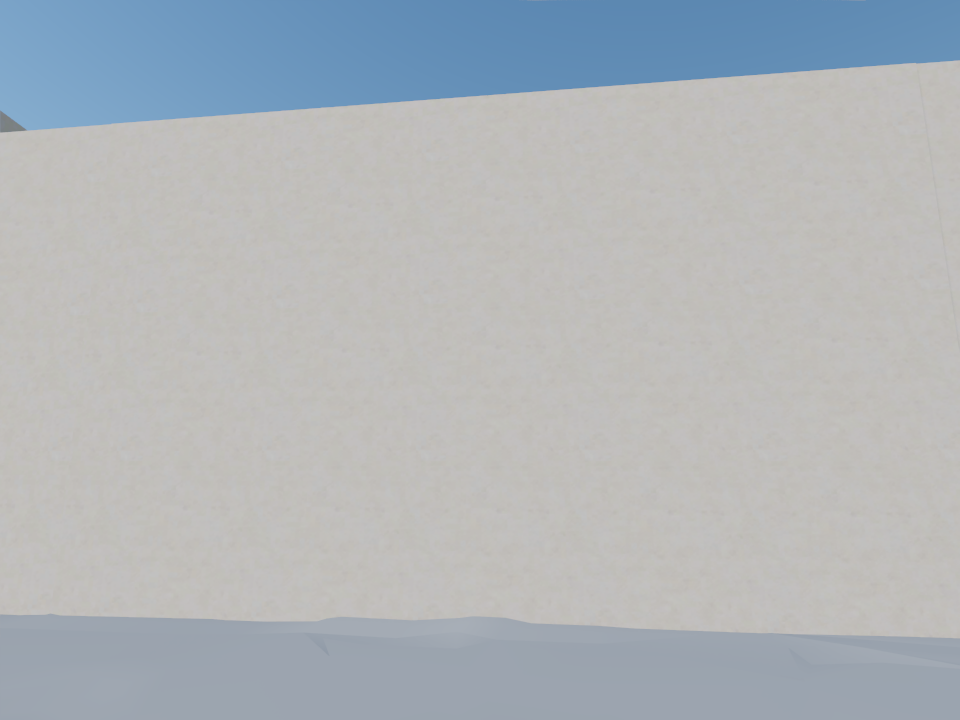
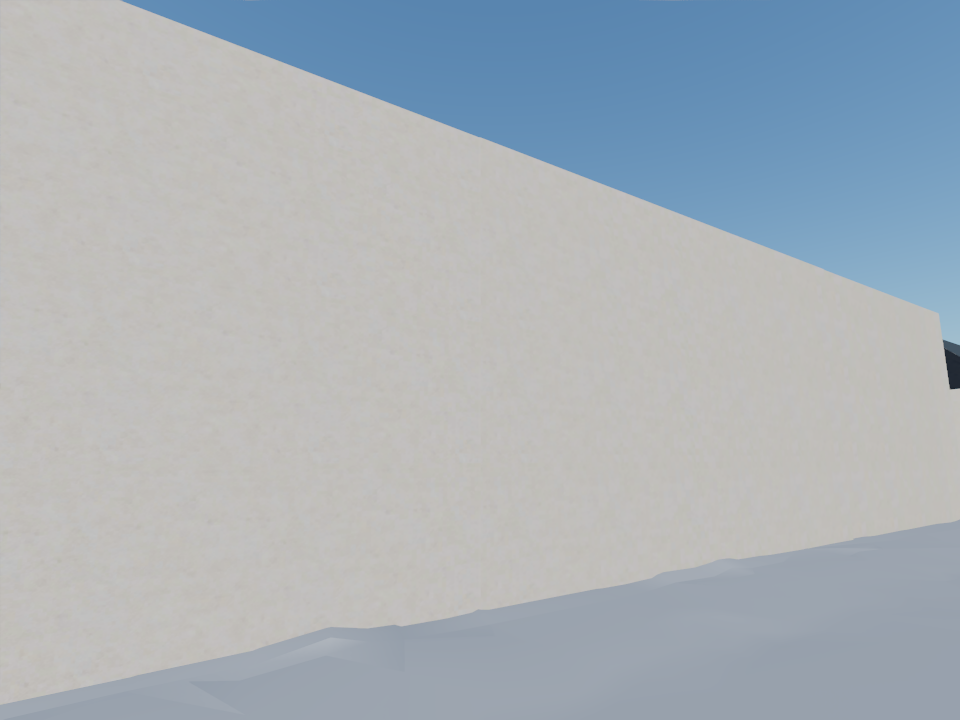
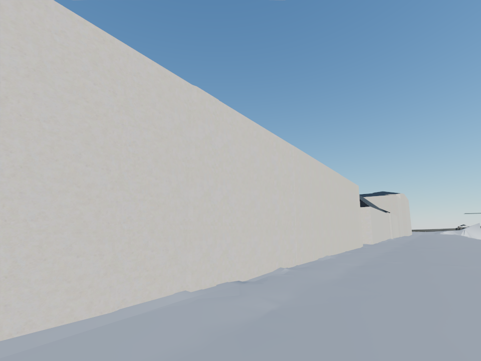

# W1-09b: authoritative facade batch, round 1

> Images derived from street-level photos (Google Street View, Apple Look Around, Mapillary) or
> Google 3D tiles were removed from the public repository on 2026-10-27; they remain in the local archive.

Round date: 2026-10-25 UTC. Sandbox: `w1-09b-facades`. No main merge or shared production writes.

## Result

Thirty new unique facade bindings pass QA and exact authoritative-geometry matching, up
from zero bindings in the inherited validated export. Thirty-one images were generated
for the 32 nearest selected surfaces. `103295900T_106` fails the unchanged generated-content
aspect check and stays unbound; `1032958849_7` has no usable reference. The
[QA results](w1-09b-facades/qa.json) and [export manifest](w1-09b-facades/bindings.json)
record those decisions. Of 761 authoritative street-facing surfaces, 731 remain on fallbacks.

The updated offline contact sheet is
`$TURKU3D_WORK/textures/round1/contact-sheet.html`; runtime-ready maps are under
`$TURKU3D_WORK/textures/assembly`. Native generated images remain cached, including the
rejected result, so future repairs and resolution changes do not discard the references
or call provenance.

The rebuilt assembly contains nine visual tiles and 64 collision tiles. L0 Brotli sizes
are 6.534, 6.269, 3.841 and 4.923 MB respectively for `t0_0_0`, `t0_0_1`, `t0_1_0`,
and `t0_1_1`, below the unchanged 8 MB limit. Exact decoded geometry errors and triangle
counts are in [assembly metrics](w1-09b-facades/assembly-metrics.json).

## Street-level evidence

Chrome WebGPU, identical registry poses, 960×720, medium quality and the same autumn
lighting. Both runs load all four L0 tiles. The after views visibly restore the wooden
wall's windows, plinth and cornice. Close views still show 32 px/m softness and plain
narrow return strips excluded from this batch's minimum-width selection.

| View | Before | After |
|---|---|---|
| `sv_01` |  | *After office facade (withheld)* |
| `sv_02` |  | *After oblique office facade (withheld)* |
| `sv_03` |  | *After along the street (withheld)* |

[Before capture metadata](w1-09b-facades/before-render.json) and
[after capture metadata](w1-09b-facades/after-render.json) preserve exact URLs, camera
poses, loaded tiles, browser version, console output and timings.

## Next round

1. Repair `103295900T_106` using its cached references and an enforced full-height layout;
   the generated-content aspect check must still pass before export.
2. Acquire a usable reference for `1032958849_7`.
3. Continue outward from the completed inventory, including the narrow return strips
   visible in `sv_02`/`sv_03`. Preserve the per-tile wire budget when choosing pixel density.
4. Recheck the combined budget when integrating W1-10 ground textures and later layers.
   This report's assembly uses the shared buildings/ground layers and W1-09 library;
   W1-10 separately reports 6.84/6.96/7.89/7.33 MB before these unique facade maps.
   Passing separate builds does not establish that their combined textures fit 8 MB.

## Scope and source geometry

The current buildings layer contains 6,370 wall surfaces, including 761 marked street-facing.
The W1-09 staging inventory was provisional: none of its 127 generated images matched the
current authoritative geometry closely enough for export. The inherited assembly manifest
therefore contained zero unique facade bindings. This round starts from that honest baseline.

The [selected inventory](w1-09b-facades/selection.geojson) preserves the authoritative feature
coordinates and heights without rounding. It selects the nearest 32 street-facing walls at
least 3 m wide and 2.5 m high, ordered by midpoint distance from E 23459668, N 6704254.
They span approximately 7–100 m from the office spawn. Small returns and roof strips remain
for later rounds. Street-facing is the buildings layer's visibility hint, not a claim that
every reference crop is unobstructed.

Existing panorama caches are read-only inputs. New crops, model outputs, PBR maps, logs,
and assembled tiles live below `$TURKU3D_WORK`. Reference discovery uses the landed Google,
Look Around, Mapillary and photosphere selectors. The W2-01 routing file was inspected and
snapshotted to `textures/round1/codex-routing.toml` in the sandbox: both building labels and
improvements use `gpt-6-astra`, medium effort. Eight shared Codex slots stream building labels
and image improvements; two post-processing workers produce the standard DeepBump/KTX2 maps.
The existing quota guard remains at 100%. No API-key image service is used. Final delivery
uses 32 pixels/metre: the initial 64 px/m PBR maps would exceed the unchanged 8 MB L0 wire
budget when added to the existing scene. Re-encoding preserves the native generated images,
facade proportions and metre UVs and requires no further model calls. The final budget pass
uses three post workers after image generation ends.

## Assembly dependency

The initial real-tile screenshots exposed the integration team's existing streaming-cache
failure: only `t2_0_0` loaded, leaving coarse roofs visible from street level. The integration
owner supplied `b153768`, cherry-picked here as `ecf7d1b`. It deduplicates textures/materials
and batches compatible primitives, preserving source-object ranges for the QA ID pass.
Both delivered street comparisons use that implementation. The earlier coarse-only and
accidental development-fixture captures are retained only as sandbox diagnostics, not as
the before/after evidence.

## Calls and wall time

There were 39 successful Codex calls: eight shared building labels and 31 image improvements,
with one image-generation call per improvement. The first model job started at 21:32:26 UTC
and the final image call finished at approximately 21:41:58 UTC (9 minutes 32 seconds elapsed).
Summed model-call wall time was 2,917.9 seconds: 404.5 seconds for labels and 2,513.4 seconds
for improvements. Concurrent call durations must not be mistaken for batch elapsed time.

Reported tokens total 3,352,719: 3,304,684 input (including 2,339,840 cached input) and
48,035 output. The reported reasoning-output subset is 1,003 tokens. Account-wide weekly
usage readings went from 1% before the first call to 10% after the last; other agents were
active, so that percentage difference is not an attributable cost for this round.

The [per-facade ledger](w1-09b-facades/facade-ledger.csv) records distance, dimensions,
reference count, improve calls/tokens/seconds, shared label identity/cost and validation
status. Shared label costs repeat on each affected facade row and must only be counted
once per label ID. [Per-call records](w1-09b-facades/calls.json) provide the unduplicated
39-call ledger, including thread IDs and timestamps. Runner timestamps in that file use
Europe/Helsinki (UTC+02 during this run); the elapsed-time summary above uses UTC.

## Verification

- [Texture gate](w1-09b-facades/texture-gate.txt): green, 95.156 s under host contention.
- Imported integration changes: type checks, unit tests, lint, dependency checks and the
  WebGPU/WebGL2 browser stage passed; browser stage wall time was 191.060 s.
- The first integration gate's packaging test failed because this fresh sandbox lacked
  `tools/validator/node_modules`. After `npm ci --prefix tools/validator`, the complete
  [affected package gate](w1-09b-facades/package-gate.txt) passed all 22 tests; green in
  68.529 s. No assertion or quality threshold was changed.
- [Report/policy gate](w1-09b-facades/report-gate.txt): green, 0.245 s.

Python test auto-worker selection was capped with `PYTEST_XDIST_AUTO_NUM_WORKERS=3`.
All source images and post-processing remain in the sandbox; raw panorama imagery is
not part of the assembled game or this repository report.

## Reproduce and resume

These commands assume the published buildings and ground layers have been copied into this
sandbox's `build/layers`, and the prior texture library/tools are available in the sandbox.
The selected inventory is a snapshot; use a newly selected authoritative inventory if the
buildings layer changes.

```sh
source ../sandbox.env
export TURKUTEX_READ_CACHE=/Users/wnt/turku3d/wt/w1-09-facades/work/cache/streetview
export FACADES="$PWD/docs/reports/w1-09b-facades/selection.geojson"
export FACADE_RUN="$TURKU3D_WORK/textures/round1"

textures/.venv/bin/python -m turkutex facade-batch refs "$FACADES" --run "$FACADE_RUN" --ref-workers 3
textures/.venv/bin/python -m turkutex facade-batch label "$FACADES" --run "$FACADE_RUN" -j 8 --max-pct 100
textures/.venv/bin/python -m turkutex facade-batch improve "$FACADES" --run "$FACADE_RUN" -j 8 --max-pct 100
textures/.venv/bin/python -m turkutex facade-batch post "$FACADES" --run "$FACADE_RUN" --ppm 32 --post-workers 3
textures/.venv/bin/python -m turkutex facade-batch report "$FACADES" --run "$FACADE_RUN"
```

The coverage report deliberately exits 1 while selected walls are missing or rejected.
That is coverage evidence, not permission to weaken the export checks. Exact prompts,
input hashes, generated-image provenance and per-attempt usage are retained in
`$FACADE_RUN/run_{label,improve}/{attempts,out,usage}.jsonl`; individual job specifications
are in `$FACADE_RUN/*.job.jsonl`. The self-contained contact sheet is
`$FACADE_RUN/contact-sheet.html`.

## Export, assembly and local redeploy

Only passing reference/geometry/scale/KTX2/hash records enter the separate assembler lookup
tree. Missing or rejected walls retain their library material.

```sh
source ../sandbox.env
export FACADES="$PWD/docs/reports/w1-09b-facades/selection.geojson"
export FACADE_RUN="$TURKU3D_WORK/textures/round1"
textures/.venv/bin/python -m turkutex facade-export \
  "$TURKU3D_WORK/build/layers/buildings/facades.geojson" \
  --source-inventory "$FACADES" --source "$TURKU3D_WORK/textures" \
  --qa "$FACADE_RUN/qa.json" --output "$TURKU3D_WORK/textures/assembly"
bash pipeline/env/run.sh python -m turku3d.package.assemble \
  --layers "$TURKU3D_WORK/build/layers" --out "$TURKU3D_WORK/dist/tiles" \
  --library "$TURKU3D_WORK/textures/assembly/library" \
  --facades "$TURKU3D_WORK/textures/assembly/facades" \
  --tile t0_0_0 t0_0_1 t0_1_0 t0_1_1
make game-preview
```

Open `http://127.0.0.1:5501/?tiles=/tiles/tileset.json` for the sandbox deployment.
The orchestrator can promote the validated assembly tree and rebuild its own deployment;
this worker does not write to shared production or restart another sandbox's server.

```sh
source ../sandbox.env
node qa/render/render.mjs --views qa/views/views.jsonl --ids sv_01,sv_02,sv_03 \
  --url http://127.0.0.1:5501/ --out "$TURKU3D_WORK/reports/facades-after" \
  --pass color --backend webgpu --timeout 180000 --extra 'tiles=/tiles/tileset.json'
PYTEST_XDIST_AUTO_NUM_WORKERS=3 GATE_PYTHON="$PWD/textures/.venv/bin/python" \
  bash pipeline/env/run.sh scripts/dev/gate --base dfb9204
```

## Rebase verification, 2026-10-26

Rebased onto main `e43067e`. Git dropped the duplicate batching commit because its
implementation was already upstream. The README conflict retains main's detailed
per-batch rendering and QA index-range explanation together with this round's source
identity wording. All facade evidence and the 30 validated bindings are unchanged;
this follow-up starts no image jobs and performs no export or deployment.

The `w1-09c-p1` through `w1-09c-p3` agents own further facade batches. Their shared
export lock contract does not change the historical sandbox-only export commands above.
The only pipeline code difference from main is removal of an unused `getBounds`
binding found by the package lint check. Rendering and assembly behavior are unchanged.

Run the following gates sequentially; this base's gate uses two pytest workers per stage,
below the requested maximum of three. Logs are retained under `$TURKU3D_WORK/reports`.

```sh
source ../sandbox.env
export TURKU3D_JOBS=3 PYTEST_XDIST_AUTO_NUM_WORKERS=3
export GATE_PYTHON="$PWD/textures/.venv/bin/python"
bash pipeline/env/run.sh scripts/dev/gate --paths \
  textures/turkutex/facade_batch.py textures/turkutex/export.py \
  textures/README.md docs/reports/w1-09b-facades.md
bash pipeline/env/run.sh scripts/dev/gate --base e43067e
```

The [texture gate](w1-09b-facades/rebase-texture-gate.txt) passed in 64.423 s.
The [final affected gate](w1-09b-facades/rebase-final-gate.txt) passed in 23.197 s,
including the 24 assembly/layer/package tests, ESLint, Knip, policy and generated materials.
The first package run found the unused import and a cache assertion while that import
was being edited; the complete affected gate passed after the source tree was stable.
