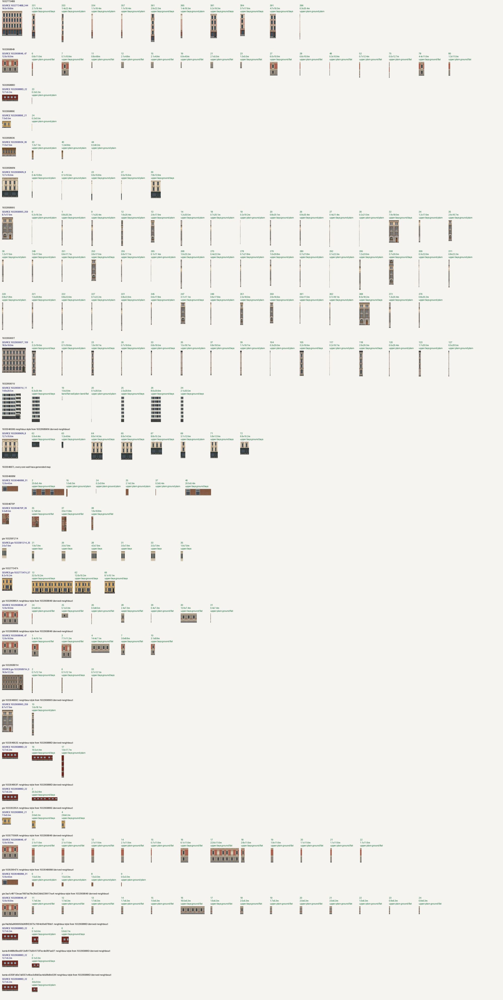

# W1-09i: one generated style per building, derived maps for its other walls

Date: 2026-10-27. Sandboxes: `w1-09i-building-styles` (tooling, landed as `bdc4411`) and
`w1-09i-building-styles-s2` (generation, publication, build). Claude worker.
Tooling: `turkutex.facade_style` (reading and cutting) and `turkutex.facade_derive`
(styles, plan, derive, contact, publish). See `textures/README.md`, "Building styles and
derived walls", for the method, the QA rules and the `style.json` schema.

## Outcome

Every one of the 218 street-facing office-core walls now has a generated or derived map in
`$TURKU3D_DATA/facade-approvals/assembly` (bound 33 → 218, inventory hash `ae9789…df2f` unchanged):

| `source_mode` | Walls | Meaning |
| --- | ---: | --- |
| `generate` | 35 | accepted image-model map (33 earlier + 2 from this task) |
| `derived` | 123 | cut from the generated map of the same building |
| `derived-neighbour` | 60 | cut from another building's style (list below, for review) |
| **total** | **218** | of 218 street-facing core walls |

- **QA.** All 183 derived walls pass the derived QA on their bay plan; none needed the
  plain-column fallback. The QA checks:
  - no seam or kept edge crosses an opening;
  - each seam's colour step stays within twice the source's own cut-to-cut step;
  - the size is exactly `metric_size(w, h, 32)`.
- **Ground audit.** The facade ground audit samples 218 of 218 approved walls with no failure;
  61 bases are buried below sloped ground, which the audit reports and accepts.
- **Codex quota.** The weekly quota read 30 % before and 30 % after: 7 image calls, 10
  reference-grid calls and 7 reviewer calls. The budget was 15 points.
- **Live release.** The integrator published `6216d61` at 12:05 with all 218 maps, before
  this slice landed, so the main-branch planner packaged it. That live build keeps the
  generated maps at 32 px/m and squeezes most derived walls to the 1–4 px/m ladder floor in
  `t0_0_0` and `t0_0_1`. The next integration after this slice lands packages all 218 with
  the ladder planner below.

## Style records

There is one `facades/<building>/style.json` next to each source map: 15 buildings, every core
building with an accepted generated map.

- **Source choice.** Each candidate map is trial-derived for every other core wall of its
  building. The candidate with the most walls passing QA wins, then one with window rows,
  then the largest.
- **Bands and window module.** These fields are image readings for review. Derivation uses
  the cut plan, so the readings do not affect any map.
- **Unreliable readings.** Walls whose openings are not glass give rough storey values, for
  example shuttered `103295888D_22`.

| Building | Address, register material, year | Source map (candidates) | Derivable walls passing | Wall colour read (`wall.hex`) |
| --- | --- | --- | ---: | --- |
| 103277348B | Läntinen Rantakatu 9, other, 1898 | `103277348B_344` (1) | 10 / 10 | `#be9e8d` pink render |
| 1032958849 | Läntinen Rantakatu 11, other, 1811 | `1032958849_47` (5) | 15 / 15 | `#a19282` (red render over rusticated stone; the reading mixes both) |
| 103295888D | Läntinen Rantakatu 13, other, 1840 | `103295888D_22` (2) | 1 / 1 | `#6d2b23` red board |
| 103295889E | Läntinen Rantakatu 13, timber, 1796 | `103295889E_21` (3) | 1 / 1 | `#b99452` yellow board |
| 103295893K | Läntinen Rantakatu 15, timber, 1809 | `103295893K_36` (4) | 3 / 3 | `#8d7357` brown timber |
| 103295896N | Linnankatu 16, other, 1887 | `103295896N_8` (3) | 5 / 5 | `#4a5155` (reads the dark shopfront band; the storeys are cream) |
| 103295899S | Läntinen Rantakatu 17, other, 1909 | `103295899S_259` (2) | 46 / 46 | `#999087` grey granite |
| 103295900T | Kristiinankatu 3, other, 1890 | `103295900T_109` (4) | 15 / 15 | `#a19287` grey render |
| 103295901U | Kristiinankatu 2, concrete, 1962 | `103295901U_11` (3) | 6 / 6 | `#d8d8d0` white concrete |
| 103304667L | Linnankatu 13, brick, 1964 | `103304667L_65` (1, new) | 0 / 0 | `#d3ccc8` off-white panels |
| 103304668M | Eerikinkatu 16, brick, 1964 | `103304668M_31` (2) | 6 / 6 | `#89634f` red brick |
| 103304670P | Eerikinkatu 16, brick, 1893 | `103304670P_39` (1) | 3 / 3 | `#8a5c50` red brick, ornament |
| gis-1032581214 | Itäinen Rantakatu 10, timber, 1865 | `gis-1032581214_25` (1, new) | 6 / 6 | `#cfbfab` cream timber |
| gis-103277347A | Linnankatu 10, brick, 1828 | `gis-103277347A_57` (1) | 3 / 3 | `#c2a365` yellow render |
| gis-103295891H | Linnankatu 14, other, 1886 | `gis-103295891H_0` (2) | 3 / 3 | `#847363` grey-brown render |

## Derived walls



- **The sheet.** It draws each source map and each derived wall at 6 px per metre.
  Each derived wall is labelled with its index, size and per-section column mode:
  - `bays`: whole bays repeated;
  - `plain`: narrower than a bay;
  - `flat`: a section without openings.
- **Narrow strips.** Most derived walls are strips 0.1–3 m wide and 10–24 m tall: corners,
  returns and the 46 small walls of `103295899S`. They keep the storey bands, cornice and
  plinth of their building.
- **Wide walls.** These repeat whole bays, for example `gis-103277347A_13` (32.5 m) and
  `103304668M_40` (20.5 m).
- **Weak case.** A one-storey style on a much taller wall stacks its wall band, as in
  `gis-103304662E_17` (1.9 × 17.7 m from the timber `103295888D`).

## Buildings without an accepted wall (step 3)

**Reference reading.** Batch 04 read the reference grid of 11 candidate walls:
- `refs` rendered Look Around → Google → Mapillary views with the rollout screening.
- `refgrid` used astra/low.
- 6 walls showed the wall.

**Generation.** Batches 05–06 generated the widest clean wall of three buildings, then a fallback
wall for the fourth. Settings were luna/low, astra/low reviewer, `-j 4`, one retry each. All
four buildings and seven image calls are in the table below.

| Batch | Wall | Size m | Result |
| --- | --- | --- | --- |
| 05 | `103304667L_65` | 10.3 × 21.5 | accepted first time (blank off-white panel gable) |
| 05 | `gis-1032581214_25` | 3.5 × 7.9 | accepted after one retry (first image missed the aspect) |
| 05 | `103304659B_67` | 8.8 × 10.2 | rejected: the first image had five evenly spaced upper windows for two pairs; the retry left a pavement strip and moved a door |
| 06 | `103304659B_72` | 6.9 × 10.2 | rejected: white canvas beside the mansard; the retry added a storey |

Ledger: `~/turku3d/logs/facade-rollout/ledger.md` and `batch-04.json` to `batch-06.json`.

- Batch 04 lists "no generated image ×6" because it only read references.
- The batch contact sheets show street photos, so they stay out of the public repository:
  `$TURKU3D_WORK/reports/w1-09i-building-styles/contact-batch-0{5,6}.jpg`
  (`~/turku3d/wt/w1-09i-building-styles-s2/work/...`).

**Neighbour styles.** The other buildings have no usable reference: the walls show boats,
pavement, hoardings or foliage, or have no full-wall view in any source. The single exception
is 103304659B, whose two tries failed. These buildings take the style of a styled building.
The ranking weighs storey difference (3 per storey, at most 6), then facade material class (2)
and era (1), then distance. The references that exist show the wrong content, so their colour
was not used. **Please review these 60 walls:**

| Building | Walls | Address, material, year, storeys | Style from | Mismatch | Distance m | Reference situation |
| --- | ---: | --- | --- | ---: | ---: | --- |
| 103304659B | 8 | Linnankatu 17, concrete, 1917, 3 | 103295896N | 2 | 28 | yellow render visible; both generations rejected |
| gis-103295885A | 7 | Läntinen Rantakatu 11, other, 1860, 2 | 1032958849 | 1 | 30 | no full-wall view in any source |
| gis-103295886B | 5 | Linnankatu 12, other, 1861, 2 | 1032958849 | 1 | 51 | hoarding, tree, construction site |
| gis-103304660C | 1 | Linnankatu 17, other, 1901, 4 | 103295899S | 0 | 91 | one 1.6 m strip |
| gis-103304662E | 2 | Kristiinankatu 5, other, 1825, 1 | 103295888D | 0 | 135 | 16.5 m wall beyond 3.5:1; earlier generation missed the aspect |
| gis-103304663F | 1 | Linnankatu 17, other, 1896, 1 | 103295888D | 1 | 151 | 20.3 × 2.8 m wall, blurred views |
| gis-103330295A | 2 | Läntinen Rantakatu 13, timber, 1784, 1 | 103295889E | 0 | 51 | no full-wall view |
| gis-103577006R | 12 | Itäinen Rantakatu 15, other, 2020, 2 | 1032958849 | 1 | 163 | moored restaurant boat and water |
| gis-103929947X | 4 | Itäinen Rantakatu 19, metal sheet, 1999, 1 | 103304668M | 2 | 234 | glass fence, site sign |
| gis-3aa1c48713ecae7687da78e28c62b9d239917ea4 | 14 | Itäinen Rantakatu 13, –, –, 2 (est.) | 1032958849 | 1 | 121 | moored restaurant boat |
| gis-f4a3b5a9696950b36f9f22675c1994c00e878bb1 | 2 | –, 1 | 103295888D | 1 | 62 | yard machinery |
| kanta-84488cf9ec6912ef917b364173f7ec4e5f91ad27 | 1 | –, 1 (est.) | 103295888D | 1 | 108 | terrace and water |
| kanta-c03581d0e7a8357e46ce3c8b92ac4cb38d9c629f | 1 | –, 1 (est.) | 103295888D | 1 | 113 | only black Look Around crops |

"est." means the storey count is estimated from the tallest wall, because the registers have none.
The two GIS "buildings" on the river at Itäinen Rantakatu 13 and 15 are restaurant boats. A
masonry style on them is a placeholder until a boat asset exists.

## Packaging: tile sizes and a density ladder

**The problem.** With 218 maps, `t0_0_0` and `t0_0_1` would need 8.98 and 9.09 MB before
facade scaling. The old planner sent the farthest facades straight to 4 px/m. It kept the
generated maps at their 32 px/m minimum (`min_pixels_per_metre`) until every other map reached
1 px/m. Here that put nearly every derived wall in those two tiles at 1–4 px/m: flat colour.

**The fix, in the packager:**
- `halve_densities` steps facades down 16 → 8 → 4 → 2 → 1 px/m, one level at a time. It
  always takes the facade with the highest planned density, the farthest from spawn among
  equals.
- A facade stops at its declared minimum, and only when everything is at its minimum does the
  planner go below.
- `facade_derive.publish` gives every generated and derived core map the same minimum,
  16 px/m (`DENSITY_FLOOR`). A building's style source therefore never stays sharp while
  its derived walls go blurry.
- The rollout README now asks for `--min-ppm 16`.

**Trade-off.** Far generated maps in the two crowded tiles now ship at 16 px/m instead of 32.
Near-spawn maps keep their source density where the budget allows.

| Tile | Live `a2bee76` (33 maps) | Before scaling, 218 maps | Sandbox build, 218 maps |
| --- | ---: | ---: | ---: |
| `t0_0_0` | 7,524,835 | 8,983,335 | 7,386,877 |
| `t0_0_1` | 7,744,852 | 9,090,896 | 7,544,468 |
| `t0_1_0` | 6,703,782 | 7,243,387 | 7,243,387 |
| `t0_1_1` | 7,534,857 | 7,565,351 | 7,565,351 |

All four tiles are under the 8 MB wire cap and the 7.6 MB headroom target. `facades_bound` is 218.

**Chrome suite.** `make tile-e2e` on the sandbox build: 31 passed, 1 skipped (`missions.spec`,
the existing synthetic-fixture skip). Draw calls on WebGPU and WebGL2 alike:

| Pose | Draws |
| --- | ---: |
| bridge gameplay pose | 458 |
| four-tile street maximum | 332 |
| aerial | 260 |
| office spawn | 407 |

All are under 500.

## Street views, both backends

Each row compares two renders of one view:
- **Left:** live `a2bee76`, with 33 generated maps and library render elsewhere.
- **Right:** this sandbox build.

The camera stands in front of a derived wall, along its normal, at eye height.

- [WebGPU](w1-09i-building-styles/game-webgpu.jpg)
- [WebGL2](w1-09i-building-styles/game-webgl.jpg)

Raw renders are in `$TURKU3D_WORK/reports/w1-09i-building-styles/{before,after}-{webgpu,webgl}/`.

**What changed.**
- Library-render walls became their building's facade, for example:
  - `gis-103277347A_13`: the yellow two-storey front repeated along 32.5 m;
  - `103277348B_381`: the pink four-storey block with its red shopfront base;
  - `103295896N_30`: the cream storeys over the dark shopfront;
  - `103304668M_40`: brick with two glazed doors.
- Neighbour styles read as plausible fronts. Examples are 103304659B as the cream 103295896N
  style and gis-103295885A_30 as the 1032958849 rusticated style.
- The farthest derived walls in `t0_0_1` show the lower ladder levels as soft, blocky detail,
  for example `103295899S_32`.

## Verification

```sh
source ~/turku3d/wt/w1-09i-building-styles-s2/sandbox.env && cd ~/turku3d/wt/w1-09i-building-styles-s2/repo
A="$TURKU3D_DATA/facade-approvals/assembly"; ST="$TURKU3D_WORK/textures/styles"; PY=textures/.venv/bin/python
COMMON=(--assembly "$A" --inventory "$A/APPROVED_INVENTORY.geojson" --staging "$ST")
$PY -m turkutex.facade_derive styles "${COMMON[@]}" --wfs "$TURKU3D_DATA/raw/wfs/work-3x3"
$PY -m turkutex.facade_derive plan "${COMMON[@]}"
$PY -m turkutex.facade_derive derive "${COMMON[@]}"
$PY -m turkutex.facade_derive contact "${COMMON[@]}" --output "$TURKU3D_WORK/reports/w1-09i-building-styles/contact-derived.jpg"
$PY -m turkutex.facade_derive publish "${COMMON[@]}"
python3 -c "import sys; sys.path.insert(0,'scripts/dev'); import live_build, os; from pathlib import Path; live_build.seed(Path(os.environ['TURKU3D_WORK']), Path(os.environ['TURKU3D_DATA']))"
make tile-build T='t0_0_0 t0_0_1 t0_1_0 t0_1_1'
bash pipeline/env/run.sh python -m turku3d.package.facade_ground_audit
make tile-e2e
```
