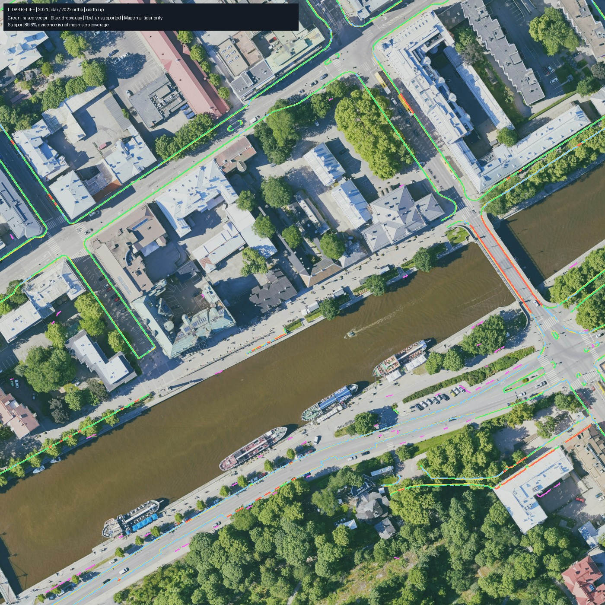

# Office core measured curbs

The lidar relief run covers the 250 m office core (collision tiles `c_1_2` through
`c_4_5`) and its 50 m margin. It reads the 2021 city lidar and 2022 true ortho
from the shared read-only data root. The ground build consumes the complete
`office-block/breaklines.json` list: measured kantakartta lines and lidar-only
additions. Raised curb heights are clamped to 6–20 cm around their measured
midpoint. `curb_dropped` remains low, and `quay` is handed to structures.

| Source measurement | Result |
|---|---:|
| Kantakartta curb length | 2,760.7 m |
| Two-sided lidar support | 2,472.7 m (89.6%) |
| Supported raised relief (>= 3 cm) | 1,610.4 m |
| Supported flush and dropped spans | 862.3 m |
| Lidar-only curb candidates | 135.3 m |
| Lidar-only quay candidates | 39.9 m |
| Lidar-only wall/planter edge candidates | 9.2 m |
| Length-weighted median / p90 step | 5.7 / 12.4 cm |

Support includes flush sections and does not imply a mesh step. The office
core collision comparison measures each raised curb segment 5.5 cm on either
side of its center. A difference of at least 3 cm counts as a real mesh step:

| Office core raised curbs | Measured length | Plain mesh step | Curb mesh step | Curb material |
|---|---:|---:|---:|---:|
| Mapped | 810.5 m | 66.7 m (8.2%) | 772.4 m (95.3%) | 810.5 m |
| Lidar-only | 83.6 m | 14.1 m (16.9%) | 83.6 m (100%) | 83.6 m |
| Combined | 894.1 m | 80.8 m (9.0%) | 856.0 m (95.7%) | 894.1 m |

All 917 measured core segments had both mesh samples. The new ground has
822,139 triangles over 64 collision tiles; the busiest tile has 25,960,
below the 150,000 limit. Ground QA passed point coverage (97.8%), seams,
interior edges, materials and water level. The smallest triangle in the 64
collision layers is 1.25e-5 m², above the shipped format's 1e-6 m² floor.
Full JSON is in
`$TURKU3D_WORK/reports/ground/{curb-coverage,ground-qa}.json`.
The full curb build took 336.6 s under concurrent host load; a hash-verified
rerun returned in 0.248 s without rebuilding the 64 tiles.

## Packaging

The four L0 tiles and 64 collision tiles assemble with the released material
fallback and a pinned 48-facade texture export (the stable input snapshot from
`fix-l0-budget`, commit `58965ff`). The largest L0 transfer is 6,424,444 bytes,
below the 8,000,000-byte cap. The other three L0 tiles are 5,635,493,
4,268,126 and 5,091,009 bytes. This package binds 48 facade textures and
does not bind the optional ground splat arrays.

Two later texture inputs were tested separately. High-resolution ground splats
with the then-current facade export reached 9,675,185 bytes. A subsequently
updated shared facade export exceeded the GLB limit at 9,962,665 bytes even
without ground splat binding. Both failed the unchanged assembler check. The
facade/assembler owners have been asked to restore size compliance before
those inputs replace the pinned package.



The map is north-up. Green marks measured raised mapped curbs, blue dropped
or quay sections, red unsupported mapped spans, and magenta lidar-only lines.
The measurements and map are generated by `turku3d.lidar relief`; the map
uses source measurements and is not a claim of collision mesh coverage.

## Reproduce

```sh
source ../sandbox.env
mkdir -p "$TURKU3D_WORK/build/layers/ground-before"
cp "$TURKU3D_DATA"/build/layers/ground/c_*.col.npz \
  "$TURKU3D_WORK/build/layers/ground-before/"
bash pipeline/env/run.sh python -m turku3d.lidar relief --scope office-block
make ground-build GROUND_ARGS="--breaklines $TURKU3D_WORK/reports/lidar/office-block/breaklines.json"
bash pipeline/env/run.sh python -m turku3d.ground.curb_coverage \
  --before "$TURKU3D_WORK/build/layers/ground-before" \
  --after "$TURKU3D_WORK/build/layers/ground" \
  --breaklines "$TURKU3D_WORK/reports/lidar/office-block/breaklines.json" \
  --output "$TURKU3D_WORK/reports/ground/curb-coverage.json"
cp -cR ~/turku3d/wt/fix-l0-budget/work/textures/assembly \
  "$TURKU3D_WORK/textures/assembly"
make tile-build T="t0_0_0 t0_0_1 t0_1_0 t0_1_1"
scripts/dev/gate
```

`ground-before` is a copy of the plain ground collision layers from the
published baseline. It must be retained separately before overwriting the
active layer with the curb build.
