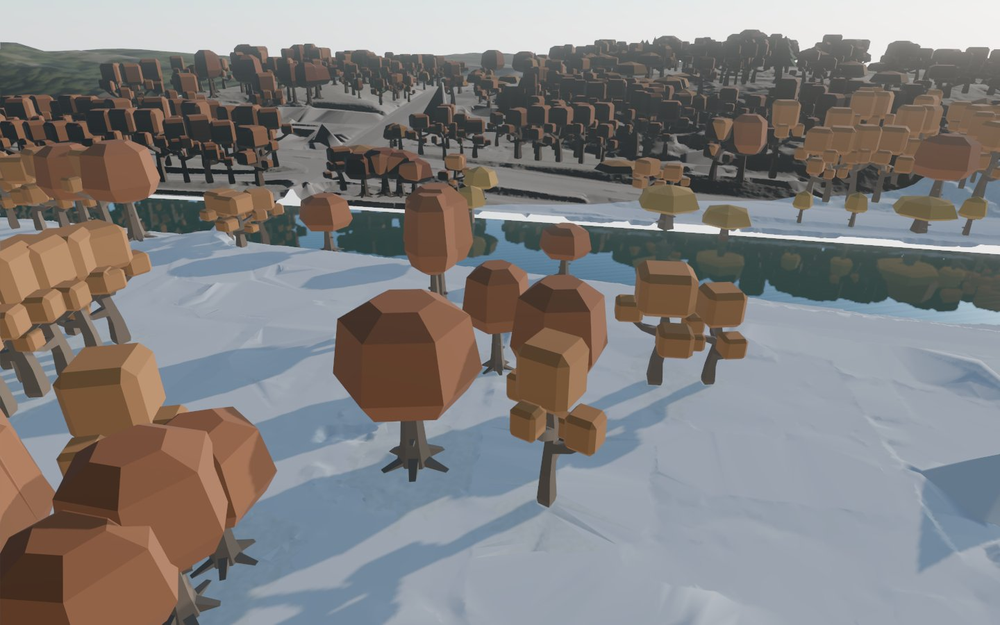

# W1-14 vegetation first version

The shared vegetation layer is published in the `w1-14-trees` sandbox at
`work/build/layers/vegetation`. Raw WFS/LAZ inputs were read only. The implementation
is rebased onto batch-1 main and preserves the texture binder extraction.

## Real data

The full four-tile AOI plus 50 m margin contains **1,067 trees**, of which **1,056**
have class-5 lidar crown support; 11 explicitly use size defaults. Sources: 670
city-register points, 269 mapped deciduous trees, two mapped conifers, three
lidar-supported row samples and 123 lidar-only candidates. Register point
coordinates are preserved. The 250 m office core contains **118 trees**, 117
measured, including 12 lidar-only candidates.

The four core visual tiles contain 788 trees. Each complete trunk belongs to one
collision tile, with material 26; crowns have no collider.

| Tile | Trees | Color-pass draws | Instance triangles | Source GLB bytes |
| --- | ---: | ---: | ---: | ---: |
| t0_0_0 | 101 | 7 | 30,012 | 126,344 |
| t0_0_1 | 259 | 9 | 90,768 | 185,848 |
| t0_1_0 | 124 | 7 | 44,546 | 131,340 |
| t0_1_1 | 304 | 9 | 99,482 | 188,760 |

These are vegetation-only geometric budgets per color pass, not whole-game frame
rates or all-pass draws. Shadow and depth passes add work. The source prototypes
have 826–1,056 triangles per tile; geometry is shared through GPU instancing.
Four [Kenney Nature Kit CC0 models](https://kenney.nl/assets/nature-kit) provide
three autumn deciduous forms and a green conifer. Original GLBs, licence text,
archive URL/hash and per-file provenance are retained in the repository/manifest.

Class-5 returns are reduced to highest-return 0.5 m canopy cells, then measured
against nearby class-2 ground. Crown ownership uses nearest trunks. Lidar-only
additions require separated, supported CHM peaks. The full cached rebuild took
74.22 seconds under concurrent host load; the initial LAZ extraction is a one-time
cost. `trees.json` contains per-tree support, measurements, sources, variant,
coordinates and fallbacks. Its hash is recorded in the layer manifest.

## Verification

```sh
source ../sandbox.env
bash pipeline/env/run.sh python -m turku3d.vegetation
bash pipeline/env/run.sh python -m turku3d.vegetation --scope phase1
.venv/bin/python -m pytest pipeline/tests/test_vegetation.py -q
scripts/dev/gate
bash pipeline/env/run.sh python -m turku3d.package.assemble \
  --layers "$TURKU3D_WORK/build/layers" \
  --out "$TURKU3D_WORK/dist/vegetation-tiles" \
  --tile t0_0_0 t0_0_1 t0_1_0 t0_1_1
```

Synthetic tests cover source priority without position drift, negative/grid-edge
ownership, canopy measurement and missing support, lidar-only additions, trunk
primitives, GPU instance identity/placement and packaged bounds, height, triangle
count and decoded precision. The final focused run passed **3 tests in 9.28 s**.
The initial branch gate was green in 410.115 s. After rebasing, the local environment
needed the newly landed `pipeline[buildings,lidar]` dependencies installed. A fresh
install exposed a missing direct `networkx` dependency used by building shell
validation; it is now declared in the buildings extra. The rebased browser stage
passed in **456.067 s**. The dependency correction reran all affected gate stages
with `scripts/dev/gate --base 4c29333`: **GREEN, 10.326 s**, including the complete
pipeline test stage in 10.283 s. Assertions and worker limits were unchanged.

## Render evidence



Real ground plus vegetation, without building shells or the external texture
library. Both Chrome WebGPU and WebGL2 loaded **32 InstancedMesh batches**, with
no page/QA errors. Camera: E 23459620, N 6704350, H 55 m; yaw 135°, pitch −25°,
vertical FOV 55°; 1440×900; default October afternoon lighting. Browser profiles
and temporary server (port 5413) were isolated and closed after capture.

Real four-tile assembly passed with **zero codec position error** in all four L0s.
Combined ground + trees brotli sizes were 1,134,297 / 2,609,922 / 1,742,984 /
2,586,516 bytes for t0_0_0 / t0_0_1 / t0_1_0 / t0_1_1. These fit the 8 MB limit.
Full backend snapshots are in `work/reports/vegetation-render.json`; both screenshots
are in `work/reports/vegetation-{webgpu,webgl}.jpg`. No uncontended FPS claim is made.

To reproduce the screenshot after assembly, run a server in one terminal:

```sh
node tools/dev/serve-dist.mjs --root "$TURKU3D_WORK/build/game" \
  --port "$((TURKU3D_PORT_BASE + 3))" \
  --mount "/tiles=$TURKU3D_WORK/dist/vegetation-tiles"
```

Then capture in another terminal (stop the server afterward):

```sh
node game/scripts/probe-page.mjs \
  "http://127.0.0.1:$((TURKU3D_PORT_BASE + 3))/?backend=webgpu&tiles=/tiles/tileset.json&cam=23459620,6704350,55,135,-25,55&qa=1" \
  "$TURKU3D_WORK/reports/vegetation-webgpu.jpg" 30000
```

## Remaining improvements

Use shared `turku3d.lidar.TileStore` once landed; refine touching-crown segmentation
and reject lidar-only building false positives; infer row trunks from peaks instead
of 8 m samples; calibrate trunk diameters; add botanical/less stylized models and
vegetation in coarse LODs and instance-level QA picking (current picking is batch-level). The 11 unsupported tree sizes remain explicit defaults.
